# 产品体验文档-网易云 VS 酷狗音乐

## 一.产品描述

### 1.体验环境：

- **网易云：**

  目标产品：网易云

  体验版本：9.6.32`

  体验设备：iphone 16pro`/`ios 26.6.1`

  体验时间：2026/11

- **酷狗音乐：**

  目标产品：酷狗音乐
  
  体验版本：20.9.1`
  
  体验设备：`iphone 16pro`/`ios 26.6.1`
  
  体验时间：2026/11

### 2.产品简介：

- **网易云音乐：**

  网易云音乐是网易公司于2013年4月23日正式推出的移动音乐应用，是一款专注于发现，欣赏，分享，创作的音乐产品。它以歌单为核心，依托专业音乐人、DJ，好友推荐及社交功能，形成个性化的音乐生态圈，以“音乐的力量”为slogan为用户提供丰富体验的音乐生活。

- **酷狗音乐：**

  酷狗音乐于2004年上线，现隶属于腾讯音乐娱乐。是一款专注于收听、翻唱、娱乐、分享的音乐产品。它以海量曲库为核心，依托蝰蛇音效、伴奏资源、k歌以及音频直播功能，形成一站式音娱服务平台，以“就是歌多“为slogan为用户提供了丰富多元的音乐娱乐体验。

### 3.产品定位：

- **网易云音乐：**

  网易云音乐是一款为喜欢音乐的人群提供个性化的社区化音乐平台。以歌单为核心，以发现、欣赏、分享、创作为主打，在不同的歌曲中找到共鸣。

- **酷狗音乐：**

  酷狗音乐是一款面向大众的一站式音娱服务平台。以海量的歌曲版权为核心，以音效、k歌、直播娱乐为主打，让用户收听、翻唱、娱乐、分享音乐，满足全年龄段多样化的用户个性需求。

## 二.用户分析

- **网易云音乐：**

  - 用户分析：

    1. 地域分布：

       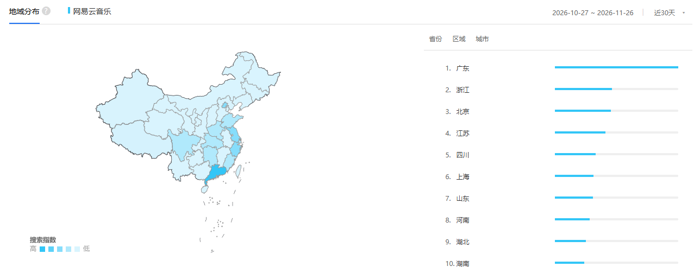

       搜索热度TOP10的省份，均为沿海经济发达城市、一二线城市。

       城市经济发展水平高，用户基数大，且年轻人分布密集，消费意愿高，消费能力强。

    2. 人群属性：

       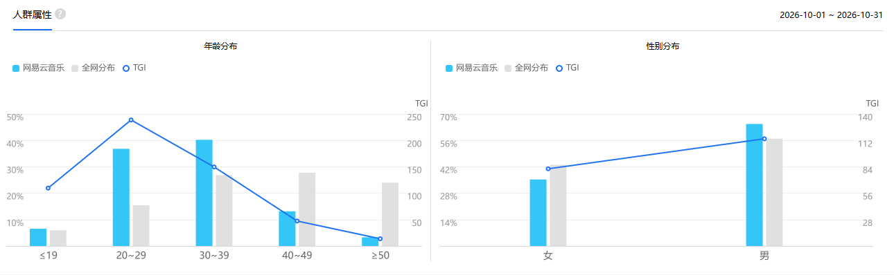

       20~29岁TCI最高，其次是30~39岁，再是19岁以下用户。青年群体占主导，男性用户占比高于女性用户。

       上学的大学生与步入职场的青年群体，是最原意为情绪价值，情感共鸣，个性化推荐等功能买单的群体。

    3. 兴趣分布：

       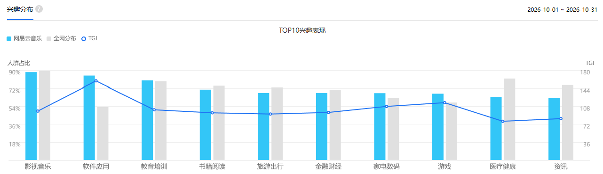

       影视音乐，软件应用，教育培训，书籍阅读，旅游出行位列前五个

       使用网易云音乐的用户的兴趣不只是单纯喜欢听歌，同时喜欢影视，阅读，学习，旅游。整体都偏向于为内容消费，为文艺买单，这也是网易云社区互动功能能运行得了，并且做出特色的原因之一。

  - 目标用户：20~39岁、集中在经济发达地区，愿意为情绪价值，灵魂共鸣的文艺内容买单的青年群体，以大学生和年轻职场用户为主。

  - 目标用户的需求：

    1. 发现与探索音乐
    2. 寻求情感与灵魂的共鸣
    3. 参与社交活动
    4. 个性化功能体验
    5. 娱乐放松
    6. 欣赏小众音乐

  - 目标用户的痛点

    1. 版权与付费问题

       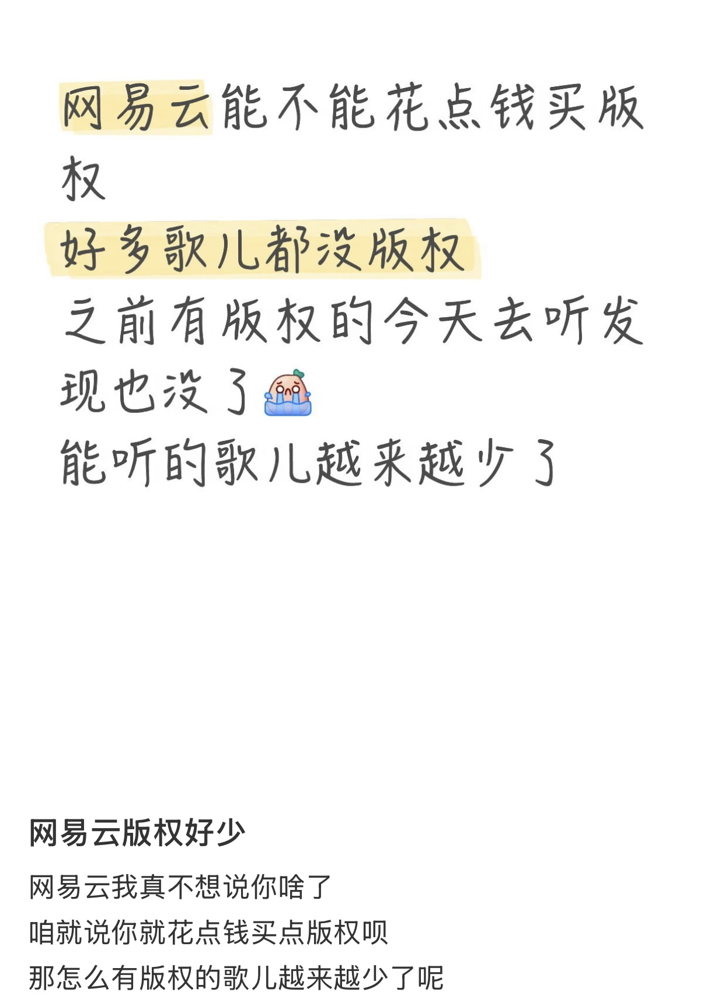

    2. 乐评质量与社区氛围下降

       

    3. 个性化功能同质化

       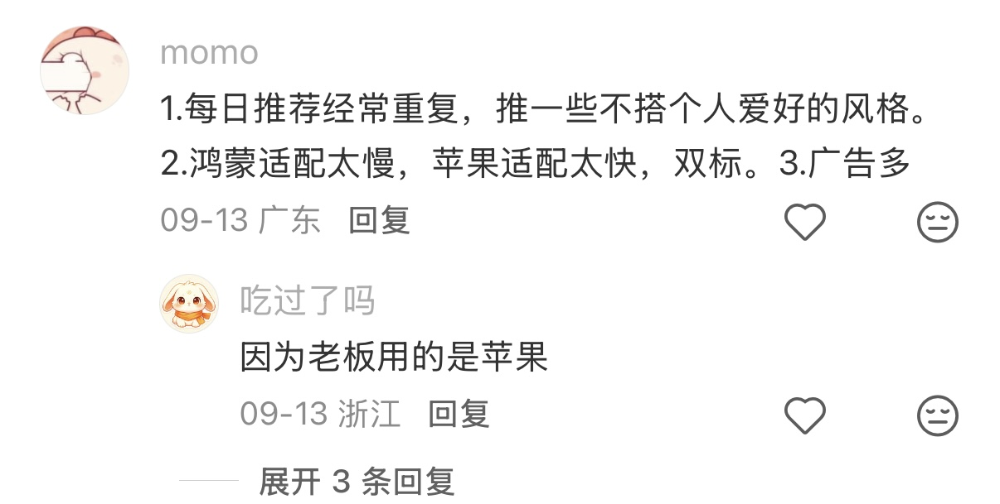

  - 使用场景：

    1. 上班通勤途中
    2. 工作学习时
    3. 休闲放松时
    4. 运动健身时
    5. 社交互动时
    6. 调节情绪时

- **酷狗音乐：**

  - 用户分析：

    1. 地域分布：

       

       热度前几的省份除沿海经济较为发达的省份外，也有人口大省和内陆省份。

       用户覆盖范围广，不局限于一二线城市

    2. 人群属性：

       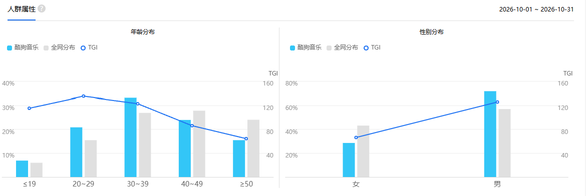

       核心年龄段为20~39岁，其余年龄段的占比差距没有那么大。男性用户搜索热度明显高于女生

       用户全年龄覆盖，既有学生，职场青年，也有中老年人使用。

    3. 兴趣分布：

       

       用户兴趣TOP10分布较为平均，兴趣方向更偏向于大众化，生活化，全面化。用户使用酷狗音乐不仅仅是为了听歌，也包含了休闲，娱乐的生活追求

  - 目标用户：20~39岁，广泛分布于全国，更注重曲库、音效，k歌等实用性功能的大众群体，这其中包括学生，上班族，中老年人。

  - 目标用户的需求：

    1. 快速查找音乐
    2. 调节音效
    3. 听有声书，电台，追短剧
    4. 娱乐放松

  - 目标用户的痛点：

    1. 推荐页功能不够个性化

       

    2. 页面不够简洁，功能冗余

       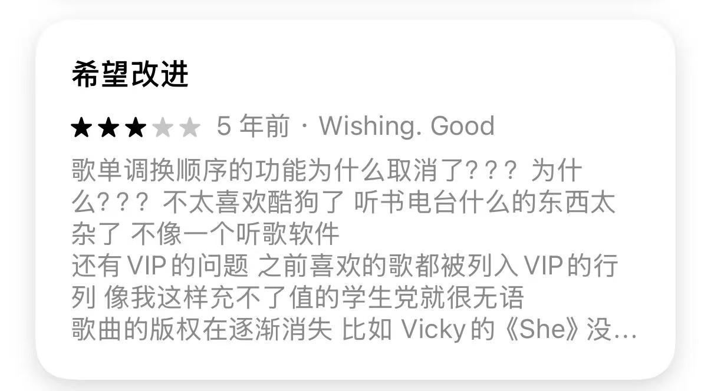

    3. 社区互动氛围差

    4. 广告太多

       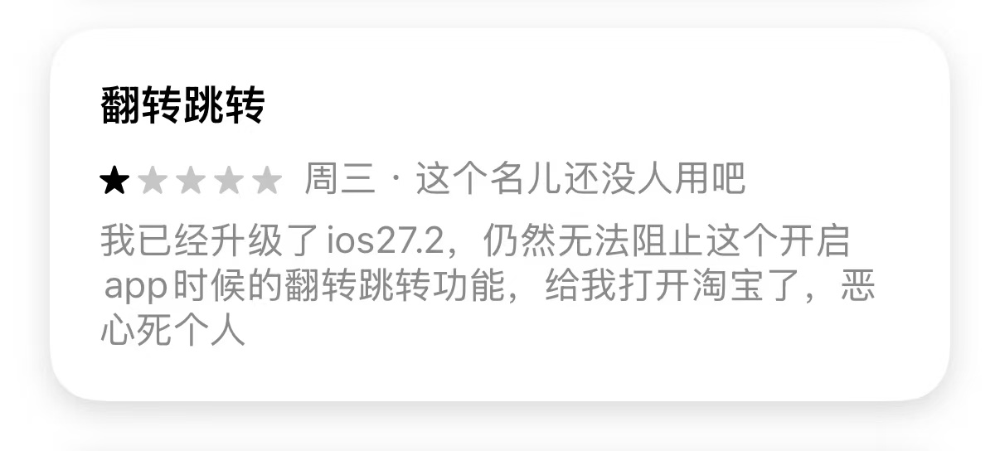

  - 使用场景：

    1. 上班通勤途中
    2. 工作学习时
    3. 休闲放松时
    4. 运动健身时
    5. k歌，ai录歌时
    6. 调节情绪时

- **二者相比：**

  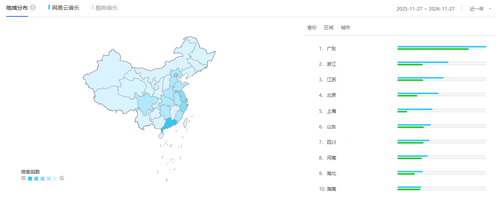

  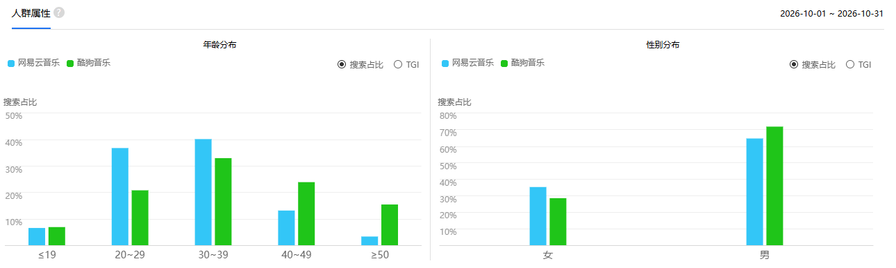

  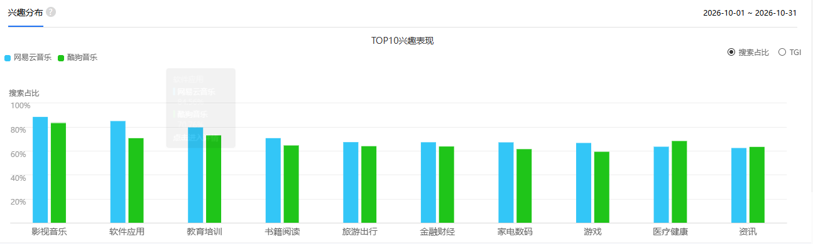

  从百度指数的对比图可以看出，二者的用户群体出现明显的分层。网易云音乐的一，二线发达沿海城市的年轻用户群体占大多数，中老年人用户较少，更看重情绪价值和灵感共鸣。酷狗音乐年龄覆盖率高，年龄跨度大，中老年人占比很高，更注重功能的多样性。

## 三.市场分析

1. 市场

   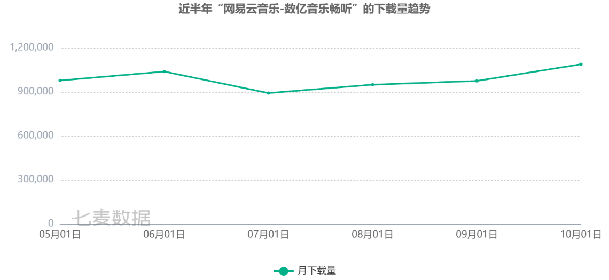

   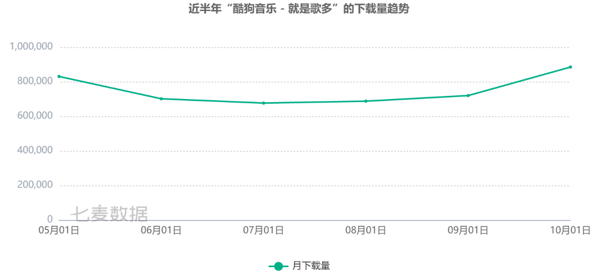

   从近半年数据来看，网易云音乐整体下载两高于酷狗音乐，但波动幅度较大。年轻群体对于曲库版权，体验感受，热门内容的反应更加强烈。而中老年用户较多的酷狗音乐则走势平稳，凭借其海量的曲库及功能维持用户基本盘

2. 竞品分析

   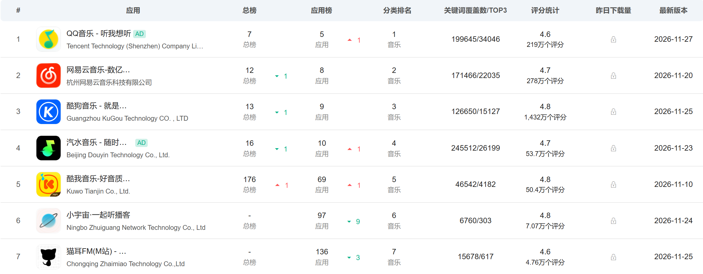

   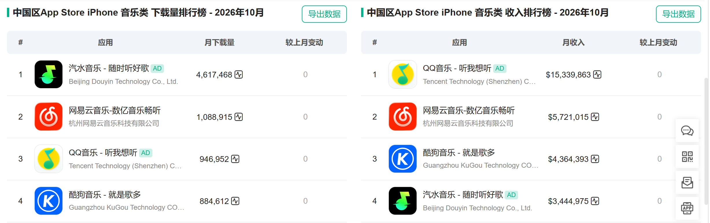

   网易云音乐和酷狗音乐在分类榜分别位列榜的第二第三。网易云音乐月下载量与收入均高于酷狗音乐，但用户评分低于酷狗音乐。

3. 商业模式与内容生态

   |          | 网易云音乐                                                   | 酷狗音乐                                                     |
   | -------- | ------------------------------------------------------------ | ------------------------------------------------------------ |
   | 商业模式 | 以会员订阅，数字专辑，内容付费为主，商城等为辅               | 以会员订阅，广告投放，k歌，音效等功能为主，直播打赏，商城等为辅 |
   | 内容生态 | 以歌单，音乐社区为主打，依托音乐人、DJ，依靠UGC歌单，乐评，社区互动，吸引年轻用户。 | 依托TME海量正版曲库，在以歌曲为核心的功能外，兼顾有声书，电台，直播，k歌等全面化工具化功能，覆盖全年龄段用户。 |

## 四.产品分析

1. 功能结构图

   - [网易云音乐](https://github.com/gjo4o4/PM-Tasks-/blob/main/Week%201/思维导图-jpg/网易云音乐功能结构图.jpg)

     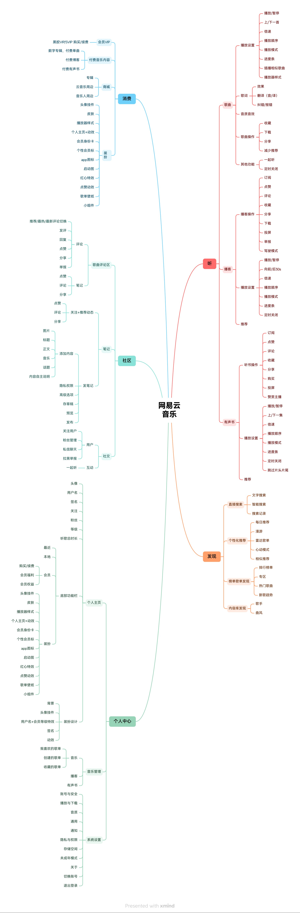

   - [酷狗音乐](https://github.com/gjo4o4/PM-Tasks-/blob/main/Week%201/思维导图-jpg/酷狗音乐功能结构图.jpg)

     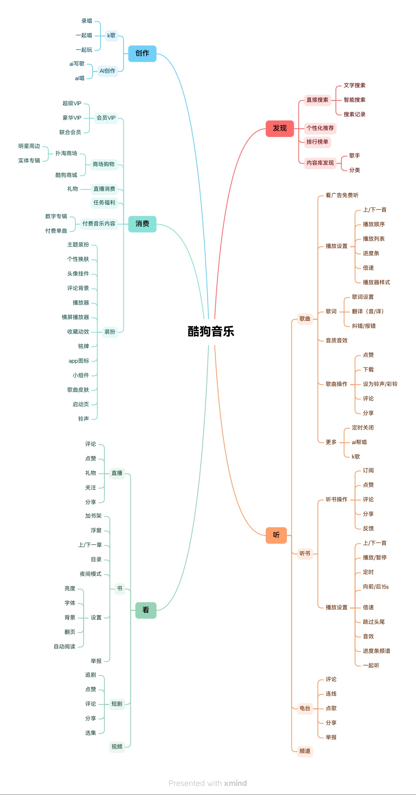

2. 信息结构图

   - [网易云音乐](https://github.com/gjo4o4/PM-Tasks-/blob/main/Week%201/思维导图-jpg/网易云音乐信息结构图.jpg)

     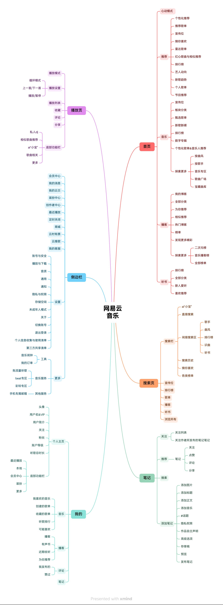

   - [酷狗音乐](https://github.com/gjo4o4/PM-Tasks-/blob/main/Week%201/思维导图-jpg/酷狗音乐信息结构图.jpg)

     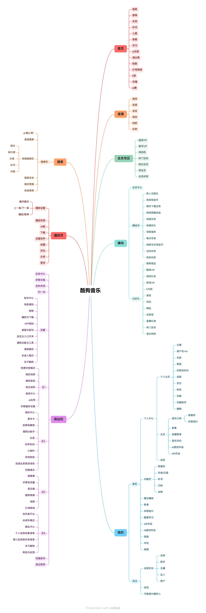

## 五.用户体验（用户体验流程）

**前情提要：**我是一个超级听歌发烧友，基本上有了自己的手机和手机号之后，就创建了各个平台的账号，像酷狗音乐月龄是六年十个月，网易云音乐是2019年7月创建的，都将近7年。我最开始使用的听歌软件应该是酷狗音乐，但在我接触到网易云音乐，qq音乐，am之后就基本上是双持或是三持，网易云一直是按年冲，qq音乐自动月月续费，am随缘续，但酷狗至今应该是没有开通过VIP。

- 听前功能体验：

  1. 要打开软件，就要点击图标。两个软件的图标都可以更换，但是网易云的图标明显看起来种类更多，看起来更让用户有想换的欲望

     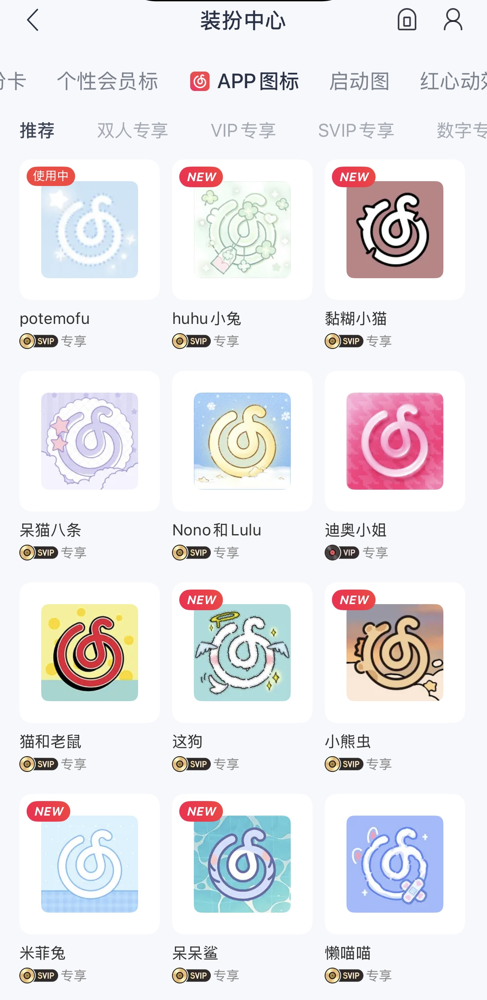

     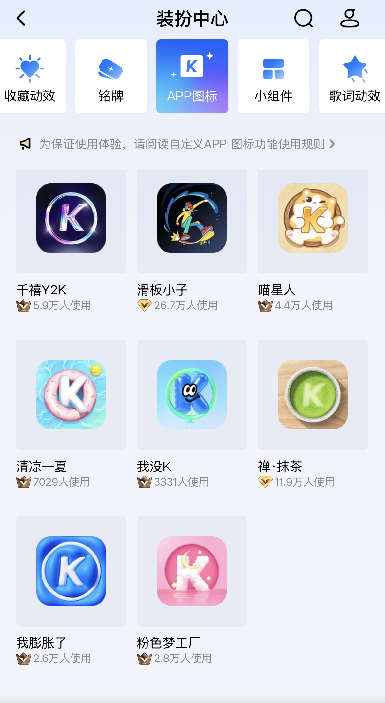

  2. 在开屏过程中，slogan页过后。酷狗有问候音效(可以关闭)和广告（时有时没有)，这个广告就会给用户的不好的观感，并且还存在跳转广告的问题；网易云如果不设置开屏特效是直接进入app首页的。这个开屏特效酷狗也是有的，在酷狗中叫启动页，但仅限VIP用户使用。

  3. 进入app后，酷狗的页面会出现签到广告，这可能是腾讯公司旗下软件的通病。反观网易云像开了纯净版一样，整个过程很丝滑。

- 首页功能体验：

  - 网易云：更着重于推荐精度，听歌体验

    以个性化推荐与发现为核心，页面简洁干净，推荐精度高。推荐分类明确，每日推荐，雷达歌单，心动模式，漫游模式等，聚焦于听歌内容，重心放在音乐本身，沉浸式听歌体验好。

    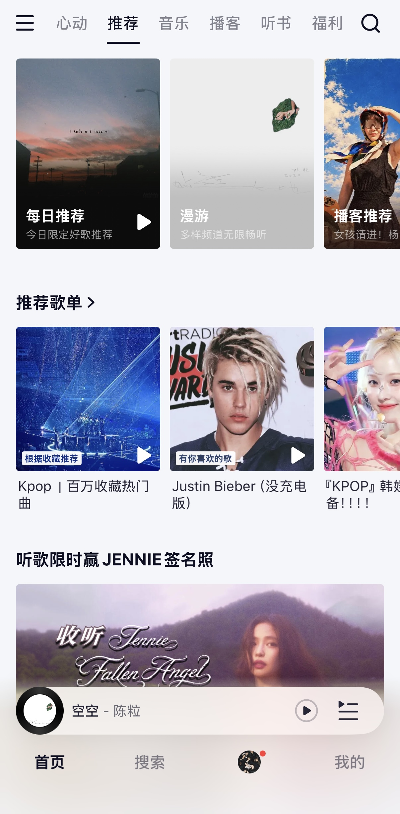

  - 酷狗：更注重于音效、曲库、功能的广度

    首页功能过度繁杂冗余，入口太多了，包括助眠，短剧，游戏，小说等功能大量非核心娱乐功能。商业板块和广告推送过多，影响用户观感和使用流畅感受。

    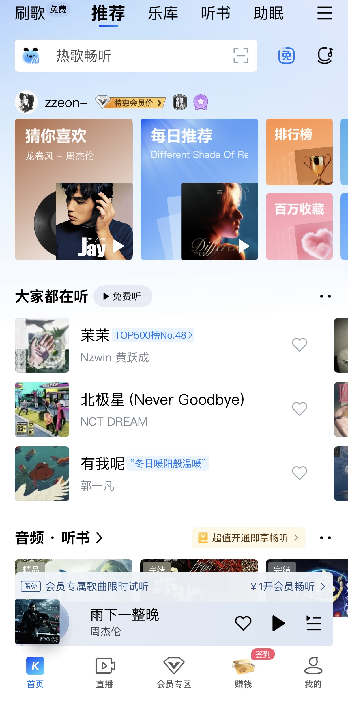

- 听歌功能体验：

  - 网易云音乐：页面设计简约干净，以专辑封面作为整个页面的视觉核心，无非核心元素。音质音效分为免费与付费两类，可供所有用户进行挑选。功能标识排布工整，将点赞，评论放在最亮眼的位置，与软件注重社交互动的定位相契合。再搭配皮肤，动效等个性化装扮设置，给用户很强的听歌沉浸感受。

    

  - 酷狗音乐：不论于核心功能的远近，将音效，伴唱，视频，限免等相关功能直接展示在页面上，功能元素过于密集与后面所要说的侧边栏一样，功能内容全部都摆出来甚至重复。音质音效和歌曲版权数量给到夯，但是音质音效仅限VIP使用者。虽然尽量满足了全年龄段用户的功能需求，但在一定程度上对听歌体验造成了影响。

    

- 社交功能体验：

  - 网易云音乐：网易云音乐的社交体系完善，关注，粉丝管理，评论区互动，分享笔记，私信聊天等社交功能集权。听歌时翻阅评论，能获得别样的听歌体验，深层的灵魂共鸣，沉浸的听歌氛围。软件把云村改为了笔记板块，与小红书类似，但并没有明显的使用感提升。

    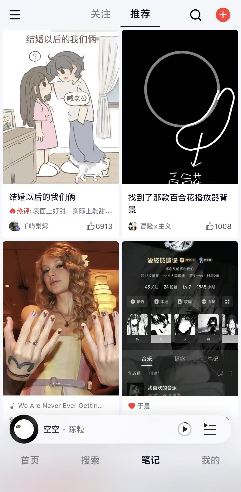

    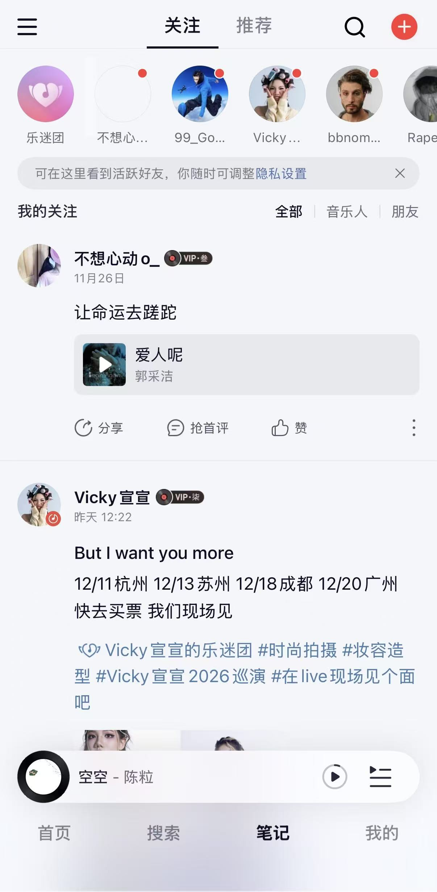

    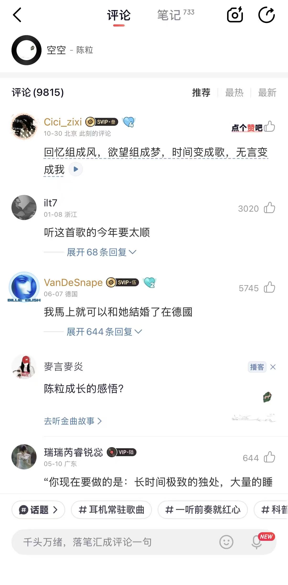

  - 酷狗音乐：没有明确的社交板块，增加的直播与电台本意是增加互动性。但内容偏向娱乐化，有擦边的味道，有关音乐的内容比较少，社交氛围较弱。

    

    

    

    

- 视觉体验：

  - 网易云音乐：分区明确，但有时找不到部分功能。页面干净简约，色调统一，观赏性强。装扮体系丰富完善，满足个性化设置需求，可打造专属的页面风格，一步一步加强用户的探索欲望。

    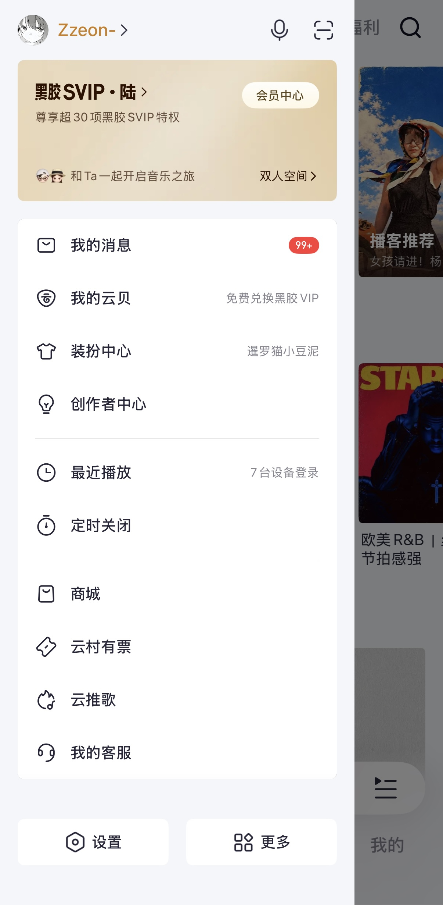

    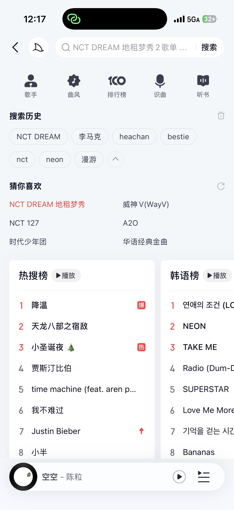

    

  - 酷狗音乐：分支过多，功能分层混乱，全部堆砌在一起，功能重复出现。页面分区较为明显，但给人一种”老辈子“的感觉。广告过多，乐库界面更像音乐软件的主页。个性化设置较少，装扮和个性化设置有待加强。

    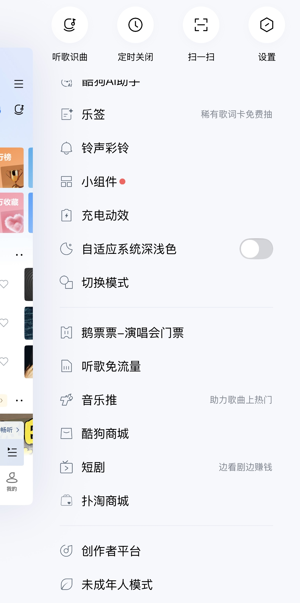

    

    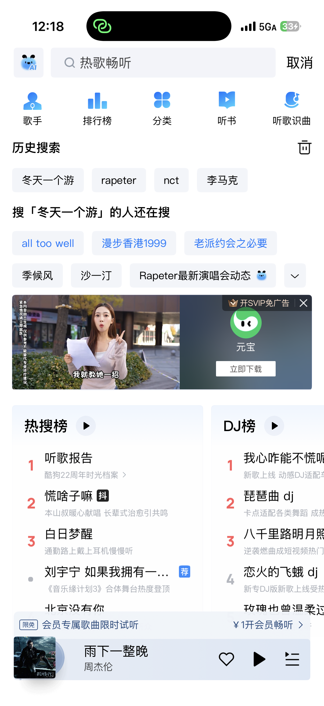

- 消费体验：

  - 网易云音乐：没有强迫用户消费的感觉。会员中心，装扮中心等付费项目入口清晰且不喧宾夺主。

  - 酷狗音乐：付费项目较多，VIP，单曲消费，音乐衍生产品等等。并且商业广告较多，与其他软件合作较多。各类消费入口随眼可见，使用体验干扰大。

    

    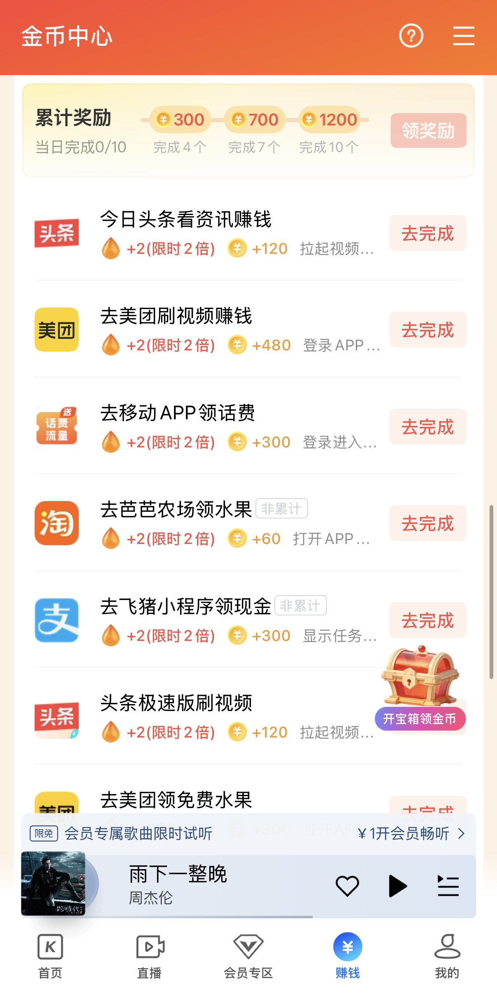

- 其他功能体验：

  - ai功能：

    二者都内置了专属的ai助手，网易云”小宝“，酷狗”酷小狗“，会推送实时热点内容或是个性化推荐内容。

    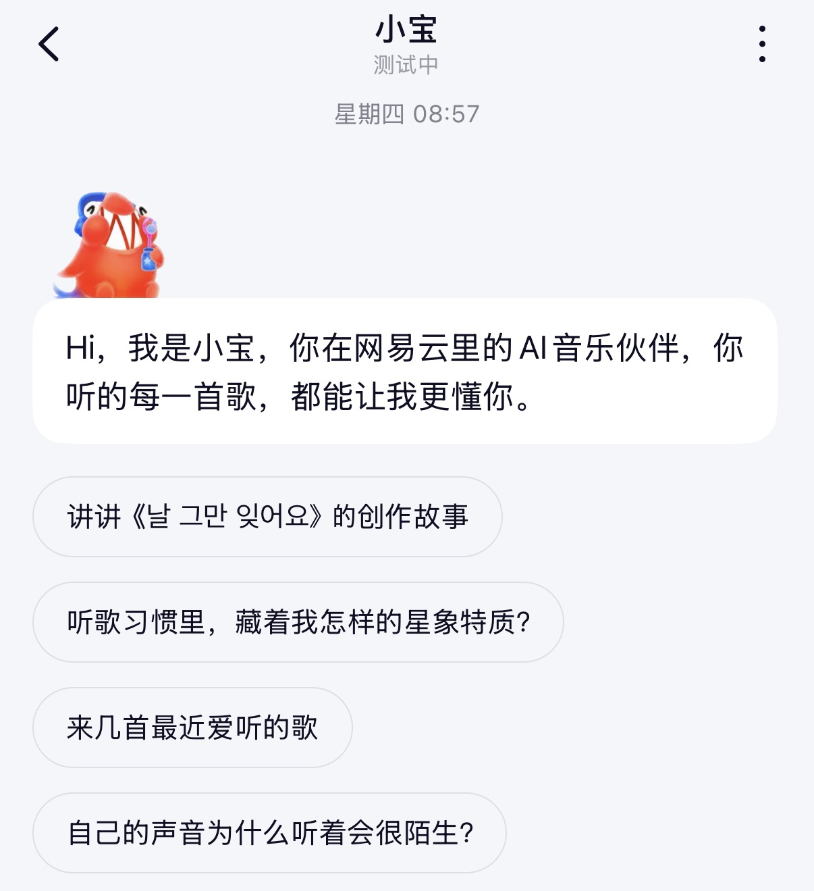

    

  - 其他：

    - 网易云音乐将听书和播客搬进app中，虽然与音乐相关性不大，但是功能拓展较为克制，与音乐页隔离开，无功无过。
    - 酷狗音乐纳入大量相关性较弱的非音乐功能，如小游戏，演出票购买等等，多而不精，还出现了一些bug（打开游戏后关不掉）

## 六.总结

- 网易云音乐：

  | W                          | S                                  |
  | -------------------------- | ---------------------------------- |
  | 热门版权不足               | 个性化推荐算法精准                 |
  | 功能增加后，页面也有些臃肿 | 社区氛围好                         |
  | 云村能力改为笔记           | 年轻用户数量多，粘性大，消费能力高 |

  | O                              | T                                      |
  | ------------------------------ | -------------------------------------- |
  | 发掘小众音乐，播客             | 腾讯旗下QQ音乐和酷狗音乐的海量版权     |
  | 社区互动社交玩法功能进一步优化 | 汽水音乐依托抖音凭借短视频流量抢夺用户 |
  | 扩展线下试听会等活动           |                                        |

- 酷狗音乐：

  | S                                    | W                        |
  | ------------------------------------ | ------------------------ |
  | 背靠腾讯，还拥有海量版权             | 社交互动氛围弱           |
  | k歌，ai唱等工具功能多                | 冗余广告，商业化投送过多 |
  | 用户覆盖全年龄段，下沉市场用户基数大 | 视觉设计效果略”土“       |

  | O                        | T                                      |
  | ------------------------ | -------------------------------------- |
  | 减少广告，商业化投送     | 网易云音乐的社区互动吸引年轻用户       |
  | 发展独特的产品风格       | 汽水音乐依托抖音凭借短视频流量抢夺用户 |
  | 拓展覆盖全生活场景的功能 |                                        |

  

## 七.参考资料

1. [网易云音乐_百度百科](https://baike.baidu.com/item/网易云音乐/4453795)

2. [网易云音乐 | 投资者关系](http://ir.music.163.com/sc/about_profile.php)

3. [酷狗音乐_百度百科](https://baike.baidu.com/item/酷狗音乐/2710730)

4. [网易云音乐 百度指数](https://index.baidu.com/v2/main/index.html#/crowd/网易云音乐?words=网易云音乐)

5. [酷狗音乐 百度指数](https://index.baidu.com/v2/main/index.html#/crowd/网易云音乐?words=网易云音乐)

6. [网易云音乐&酷狗音乐 百度指数](https://index.baidu.com/v2/main/index.html#/crowd/网易云音乐?words=网易云音乐,酷狗音乐)

7. [网易云音乐 apple store](https://apps.apple.com/cn/app/酷狗音乐-就是歌多/id472208016)

8. [酷狗音乐 apple store](https://apps.apple.com/cn/app/酷狗音乐-就是歌多/id472208016)

9. [【下载量/收入榜单】-中国区热门App丨App Store热门应用-七麦数据](https://www.qimai.cn/rank/downincome/type/hot_app/genre/6011/device/iphone/month/2026-10)

   
